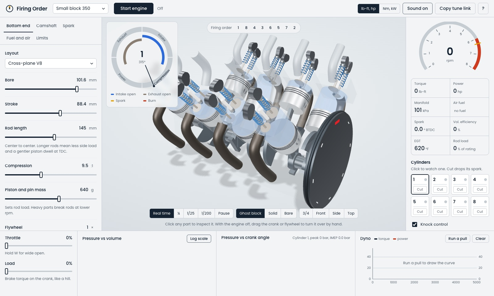

# Firing Order

A 3D engine you can tune in the browser. Pistons, rods, crank, cams, valves and springs all move off one crank angle model, and the numbers on the gauges come from actually simulating the gas in each cylinder, not from a lookup table.



## What you can do

- Start it, blip it, hold it on the limiter, put load on it
- Pick a layout: single, 45° V-twin, I3, I4, I6, cross-plane V8 (SBC or LS firing order), flat-plane V8, or a one, two or three rotor Wankel
- Load my own truck: a 2004 Tahoe LM7 with a Melling MTC-8 cam, headers, cold air and no knock sensors on 87, next to a stock LM7 so you can pull both and see the cam swap
- Change bore, stroke, rod length, compression, cam duration, centerlines, lift, springs, runner length, boost, AFR, octane
- Edit the spark table cell by cell and watch the live cursor move around it
- Run a dyno pull and compare it against the last one
- Slow it down to 1/200 and watch each stroke, flame front and valve event
- Click any part to see what it is doing right now (piston speed and g load, rod tension, valve lift, spark timing, burn point)
- Turn the crank over by hand with the engine off and feel the compression in the torque reading
- Cut spark to a cylinder and hear the miss
- Break it. Over rev the rods, float the valves, or knock a hole in a piston

## How the sim works

Each cylinder is a single zone of gas tracked by mass, temperature and how much of it is still fresh air.

- **Kinematics**: exact slider crank. Piston position, velocity and acceleration come from rod length and stroke, so rod ratio actually matters.
- **Valves**: lift profiles from duration, centerline and lift. Flow through each valve is a compressible orifice (choked or not) using curtain area.
- **Manifold**: a plenum fed by a throttle plate and an idle bypass. MAP comes out of the fill and empty balance, nothing is faked.
- **Combustion**: Wiebe burn starting at the spark angle plus an ignition delay. Burn length stretches with rpm, lean mixtures and low load.
- **Heat loss**: Woschni style wall heat transfer.
- **Knock**: Livengood-Wu integral on the end gas using the Douaud-Eyzat delay correlation, so octane, compression, spark and load all play in. Knock control pulls timing per cylinder.
- **Torque**: sum of `(p - p_atm) * dV/dtheta` across cylinders minus friction. Pumping losses, cam overlap and spark timing all show up without being special cased.
- **Turbo**: spool driven by exhaust mass flow, boost limited by the target, simple intercooler.
- **Intake inertia**: after BDC the moving charge keeps packing the cylinder, harder the faster it is going. That is what a late closing intake valve cashes in on at high rpm, and why a bigger cam loses a bit down low.
- **Failures**: rod tension `m r w^2 (1 + r/l)` against rod strength, valve float from spring rate and lift, piston damage from accumulated knock.

### Rotary

Each rotor flank is treated as its own chamber running a four stroke cycle over 1080 deg of e-shaft. Chamber volume is a pure sinusoid in rotor angle, `V = Vmin + Vh/2 (1 - cos(2 phi / 3))`, with `Vh = 3 sqrt(3) e R b` (654 cc for a 13B), so the same gas model runs on it untouched. Ports replace valves and are set by open and close angles like a port timing card. The 3D view is built from the real epitrochoid, `x = e cos 3t + R cos t`, with the rotor riding the e-shaft lobe at a third of shaft speed, so the three chambers you see are the ones being simulated.

It is tuned to land in the right ballpark (a stock-ish 350 makes around 340 lb-ft and 330 hp) rather than to match any real engine. MBT spark falls out of the model instead of being hard coded, which makes the spark table actually worth playing with.

Sound is generated live. Every exhaust valve opening schedules a pulse sized by cylinder pressure at blowdown, so firing order, the lumpy twin, misfires and the limiter all come out of the sim.

## Keys

| Key | Does |
| --- | --- |
| Space | Start or stop |
| W | Full throttle while held |
| 1 to 8 | Watch a cylinder |
| S | Cycle slow motion |
| P | Pause |
| B | Cycle block view |
| D | Dyno pull |
| Esc | Close part details |

## Running it

```bash
npm install
npm run dev
```

`npm run build` outputs a static site to `dist/`. Pushing to `main` deploys it to GitHub Pages through the workflow in `.github/workflows`.

## Stack

TypeScript, three.js, Vite, Web Audio. No framework, the UI is plain DOM.

```
src/
  sim/       engine model, layouts and firing angles, tunes and presets
  render/    three.js scene, procedural engine geometry
  audio/     procedural exhaust, intake and knock sound
  ui/        tune panel, spark table, gauges and charts
```

## License

MIT
